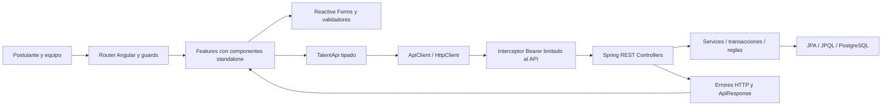

# Arquitectura del frontend

## Criterio de diseño

Angular 22 ya era la versión del repositorio. Se conservó y se añadieron componentes standalone con carga diferida, TypeScript y plantillas estrictas, formularios reactivos y SASS. Las plantillas HTML y el CSS compilado son parte de Angular; el código de comportamiento es TypeScript. No hay una aplicación paralela en HTML/JS ni un framework distinto.

Se separa por capacidades de negocio, con infraestructura compartida en `core` y componentes reutilizables en `shared`. Cada componente presenta datos y recoge acciones; `TalentApi` describe los contratos de negocio, `ApiClient` resuelve transporte y el backend aplica las reglas y transacciones. Los DTO de `models.ts` conservan los nombres JSON del Java actual. Las propiedades opcionales permiten tolerar campos ausentes; los formularios de escritura aplican los obligatorios.

## Rutas y permisos

| Ruta | Roles de interfaz | Comportamiento |
|---|---|---|
| `/`, `/ingresar`, `/registro` | Público | Presentación, login y registro de postulante |
| `/app/inicio`, `/app/vacantes` | Todos autenticados | Inicio y vacantes; el postulante ve las publicadas |
| `/app/perfil` | Postulante | Contacto, educación, experiencia, habilidades y completitud |
| `/app/vacantes/nueva` | Reclutador, coordinador, administrador | Borrador con requisitos y pesos |
| `/app/postulaciones` | Todos autenticados | Propias, asignadas o por vacante según rol |
| `/app/postulaciones/:id` | Usuarios de su ámbito | Matching, historial y feedback. Se verifica pertenencia en interfaz antes de cargar detalles |
| `/app/entrevistas` | Equipo | Consulta y estados; agendamiento para reclutador/coordinador/admin |
| `/app/evaluaciones` | Evaluador, coordinador, administrador | Consulta; escritura para evaluador/coordinador |
| `/app/indicadores`, `/app/usuarios` | Coordinador y administrador | Indicadores y cuentas; desactivación solo administrador |

La autorización de interfaz orienta la navegación. La autorización definitiva debe ejecutarse en el backend, incluido el control de propietario y asignaciones. Nunca se debe confiar en el rol recibido desde el navegador como evidencia de identidad.

## Estado y comunicación

- Signals para sesión, resultados, filtros, carga y errores. `computed` deriva listas y páginas sin duplicar datos.
- RxJS gestiona HTTP, composición de perfil/postulaciones y finalización de cargas.
- `input()` y `output()` comunican los componentes de formulario y los editores de requisitos/criterios con cada feature.
- Reactive Forms implementa required, formatos, longitudes, intervalos numéricos y orden de fechas. La API vuelve a validar reglas del dominio.
- No se reintentan automáticamente POST/PATCH para evitar escrituras duplicadas. El usuario puede reintentar lecturas.
- Errores de sección permanecen junto a la consulta. Los avisos de éxito se pueden cerrar, tienen `role=status` y no desaparecen antes de poder leerse.
- El token vive en memoria. Reduce su persistencia a cambio de requerir login tras recarga. La expiración no verifica firma en cliente; la firma la verifica Spring.
- La configuración se carga al arrancar. Si falta o es inválida, el arranque falla en lugar de elegir silenciosamente otro backend.

## Escala

La API actual devuelve arrays completos y no soporta paginación ni filtros de servidor. La paginación visual limita el DOM a 9 vacantes o 15 filas, pero **no reduce el tamaño de la respuesta HTTP**. Para la carga histórica propuesta deben añadirse `Pageable`, búsquedas, orden e índices en Spring antes de atribuir rendimiento bajo carga al sistema. No se hace una consulta HTTP por fila para construir el dashboard.

## Identidad visual

Fondo gris azulado `#eef1f8`, azul principal `#2639e8` y degradados rosa, violeta y celeste. Tipografía local Segoe UI, cabecera horizontal, menú del avatar y espacio personal en tres columnas. El logo conserva el emblema original con flecha ascendente, recoloreado en azul y lavanda para la cabecera y el favicon. La portada usa ilustraciones 3D propias generadas para TalentFlow360 y optimizadas en WebP. No se usan marcas ni fotografías de las referencias.

El selector Postulante/Equipo orienta el acceso, pero no decide el rol: este siempre llega de la sesión validada por el backend. Google y LinkedIn conservan su aspecto habitual a color. Al pulsarlos muestran un aviso de que el acceso aún no está disponible, porque no existen endpoints OAuth en el backend actual. Los botones no autentican ni simulan una sesión. La ayuda de acceso también informa que la recuperación automática aún no está disponible.

Brand, Footer, CategoryLinks y OpportunitySearch son componentes compartidos. El buscador conserva puesto y ubicación a través del login. Las empresas del espacio personal se derivan exclusivamente de las vacantes publicadas que devuelve la API. Los iconos de sectores de la portada son áreas profesionales, no logos de supuestas empresas asociadas.

Los recursos y sus prompts exactos se registran en `docs/recursos-visuales.json`. El presupuesto de estilos por componente se ajustó al portal visual: advertencia de 12 kB y error de 16 kB. El presupuesto inicial de JavaScript se conserva en 500 kB de advertencia y 1 MB de error.

De las referencias se adoptó la búsqueda por puesto/lugar de Bumeran, la orientación al primer empleo de CVMatcher/PractiMatch y la separación de experiencias de candidatos y empresas de HireClinch. El matching se presenta como comparación de competencias, sin atribuirle IA ni capacidades que el backend no tiene.

Accesibilidad: idioma español, enlaces semánticos, labels de formulario, nombres accesibles, foco visible, mensajes de carga/error, enlace para saltar al contenido, menú móvil y reducción de animaciones según preferencia. No se afirma certificación WCAG sin auditoría completa.

## Fuentes

- Caso TalentFlow360.pdf y Avance 2.pdf suministrados por el equipo, matriz y RF/RNF del capítulo 2.
- Backend `b918f144ab16b6146174a25e0eb08ab7f0f498c6`.
- [Angular: guía de estilo](https://angular.dev/style-guide), [formularios reactivos](https://angular.dev/guide/forms/reactive-forms), [interceptores](https://angular.dev/guide/http/interceptors), [guards y autorización en servidor](https://angular.dev/guide/routing/route-guards).
- [Bumeran](https://www.bumeran.com.pe/), [CVMatcher](https://www.cvmatcher.app/), [PractiMatch](https://practimatch.com/en/), [HireClinch](https://www.hireclinch.com/). Consultados el 14/11/2026.
